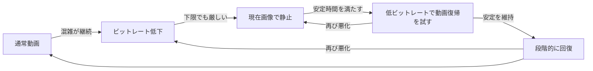

# 外配信の音声優先・現在画像静止の実現性と設計候補

> 2026-09-22追記: 推奨案の初回範囲は採用済み。現在の正式仕様は[外配信仕様](../features/outdoor-streaming.md#音声優先の自動制御)、判断記録は[ADR 0015](../adr/0015-adopt-audio-first-outdoor-adaptation.md)を参照する。以下の「未採用」「未決定」「今回は仕様を更新しない」は2026-09-20時点の調査経緯であり、現在の仕様を上書きしない。実装・実機検証は引き続き未完了。

2026-09-20調査。**検討資料であり正式仕様ではない。製品コード・正式仕様は変更していない。** 利用者から提示された案を保存し、採用前に必要な判断と検証を整理する。確認基準は作業ツリーの外配信仕様・Android実装（HEAD `ea529b951057f40b1fb05c1296381fa5eab8d893`、作業開始時に別件の変更あり）。

## 結論

「自動で映像ビットレートを低下 → 現在のカメラ画像を保持して再エンコード → 低ビットレートの動画で復帰を試す → 段階的に回復」は実現可能性が高い。固定版ライブラリに必要な構成要素がある一方、音声の連続性と送信量の改善は実機未検証であり、保証しない。特に共有送信キュー、キーフレームの瞬間負荷、静止中の回復判定、映像だけの故障復旧が設計上の重点となる。根拠は次節の一次情報に分けて示す。

推奨は、自動モードでの現在画像静止を第一段階の採用候補とし、固定モードでの緊急介入を独立した未決定事項にすること。評価はOBSで復号された配信マイク音声の途切れ・遅延を最優先とする。完全な通信断、音声分にも足りない帯域、OSによる取得・プロセス停止は解消できない。

## 利用者の案として保持する前提

- 音声をできるだけ最後まで継続する。映像と音声は当面同じSRT接続へ送る。
- 映像ビットレートは「固定／自動」を選択し、映像形式にはH.265（HEVC）を追加する。
- 自動で映像を下限まで下げても回線が厳しければ、その時点の取得済みカメラ画像を保持して繰り返しエンコードする。通常の緊急静止には別の待機画像を使わない。
- 同じ圧縮済みフレームを再送する方式ではない。保持した未圧縮画像から新しい時刻情報を持つ映像を生成し、マイク音声を継続する。
- 安定後は低いビットレートで動画へ戻し、頻繁な往復を防ぎながら品質を戻す。
- スマホの最後の取得画像とOBSの最後の受信・表示画像は一致するとは限らない。
- 手動の「映像を隠す」は自動制御より優先し、自動復帰でカメラを表示しない。
- 固定モードへの適用と「音声優先」独立設定は未決定。ここで確定した扱いにしない。

## 確認できた事実と根拠

### 現行アプリ

| 確認事項 | 現状・根拠 |
| --- | --- |
| 採用ライブラリ | [app/build.gradle.kts](../../android/app/build.gradle.kts) 57行でRootEncoder 2.8.1固定。以降の外部コード参照は同版commit `cca548ab7942ab50d34dede272d5da90d46c6b67` を使う |
| 映像形式と品質 | [外配信仕様](../features/outdoor-streaming.md#送信品質とエンコード設定) はハードウェアH.264、送信中の品質固定。ビットレート下限は0.5Mbps。[OutdoorQuality.kt](../../android/app/src/main/java/jp/casmate/app/outdoor/OutdoorQuality.kt) 7–36行は固定値の保存・検証で、codecや固定／自動はまだない |
| 対応判定 | [OutdoorCapabilities.kt](../../android/app/src/main/java/jp/casmate/app/outdoor/OutdoorCapabilities.kt) 31–36行は `video/avc` を調べる。HEVC選択時には対象codec・選択する実エンコーダー・品質範囲を一致させる変更が必要 |
| 再接続 | [OutdoorService.kt](../../android/app/src/main/java/jp/casmate/app/outdoor/OutdoorService.kt) 166–179行はソースとcodecを維持してSRT再試行。259–265行に接続成功時のキャッシュ破棄とキーフレーム要求が**すでにある**。追加機能として重複提案しない |
| 手動非表示 | 同ファイル354–418行はカメラ停止、黒／保存画像への入力交換、復帰とキーフレーム要求を行う。[OutdoorPlaceholder.kt](../../android/app/src/main/java/jp/casmate/app/outdoor/OutdoorPlaceholder.kt) 79行以降はBitmapを周期描画するが、現在カメラ画像の保持機能ではない |
| 故障による全停止 | OutdoorService.kt 228–234行では映像・音声codecエラーがともに `fail` へ進む。311–319行の通常カメラ故障も全停止になり得る。434–456行でstream・マイク等を解放する。手動非表示からのカメラ復帰失敗には既に音声を残す経路がある |
| 状態モデル | [OutdoorRuntime.kt](../../android/app/src/main/java/jp/casmate/app/outdoor/OutdoorRuntime.kt) 6–18行は `videoHidden` 等で非表示を扱い、自動静止の理由はまだ区別しない。再接続・非表示・マイクミュートは別の状態として維持する必要がある |
| 現在の計測 | [OutdoorStatistics.kt](../../android/app/src/main/java/jp/casmate/app/outdoor/OutdoorStatistics.kt) 6–20行は送信バイト差分、RTT、NAK要求数等を表示。OBSで音声が再生されたかは計測していない。NAK要求数を固有損失率としない契約は[通信詳細](../features/outdoor-streaming.md#通信状態の詳細)にある |

### AndroidとRootEncoderの構成要素

- Androidは実行中の映像目標ビットレート変更APIを提供する。これは目標値であり、回線上の送信量上限の保証ではない。[MediaCodec.PARAMETER_KEY_VIDEO_BITRATE](https://developer.android.com/reference/android/media/MediaCodec#PARAMETER_KEY_VIDEO_BITRATE)
- キーフレーム要求は早期生成の要求であり即時完了通知ではない。再接続・参照画像を壊す破棄・映像codec再準備では、要求に加えて実際の生成を確認する設計が必要。[MediaCodec.PARAMETER_KEY_REQUEST_SYNC_FRAME](https://developer.android.com/reference/android/media/MediaCodec#PARAMETER_KEY_REQUEST_SYNC_FRAME)
- AndroidにはCBR／VBR等のモードがあり、対応モードはcodecごとに確認する。「固定／自動」はアプリの目標値制御方針であり、CBR／VBRの選択とは別の軸。[EncoderCapabilities](https://developer.android.com/reference/android/media/MediaCodecInfo.EncoderCapabilities#isBitrateModeSupported(int))
- 固定版RootEncoderは対応エンコーダーでCBRを既定指定する。`setVideoBitrateOnFly` は目標変更を要求するが実データ量の確認結果を返さない。静止入力だけで十分な送信量低下が起きるとは扱えない。[VideoEncoder.java 141行以降](https://github.com/pedroSG94/RootEncoder/blob/cca548ab7942ab50d34dede272d5da90d46c6b67/encoder/src/main/java/com/pedro/encoder/video/VideoEncoder.java#L141)、[動的変更 239行以降](https://github.com/pedroSG94/RootEncoder/blob/cca548ab7942ab50d34dede272d5da90d46c6b67/encoder/src/main/java/com/pedro/encoder/video/VideoEncoder.java#L239)
- 同版はH.265のSRT送信とMPEG-TS化に対応し、VPS/SPS/PPSを扱う処理もある。ライブラリの方式対応は確認済みだが、端末・OBSでの成立は未検証。[SrtClient.kt 111行以降](https://github.com/pedroSG94/RootEncoder/blob/cca548ab7942ab50d34dede272d5da90d46c6b67/srt/src/main/java/com/pedro/srt/srt/SrtClient.kt#L111)、[H265Packet.kt 51行以降](https://github.com/pedroSG94/RootEncoder/blob/cca548ab7942ab50d34dede272d5da90d46c6b67/srt/src/main/java/com/pedro/srt/mpeg2ts/packets/H265Packet.kt#L51)
- RootEncoderには映像入力だけを交換する `changeVideoSource`、映像だけをリセットする `resetVideoEncoder` がある。入力交換と映像codec再準備は異なる処理であり、後者は音声無中断の復旧を保証しない。リセット失敗時はfalseを返し、映像Surfaceが未再接続になり得る。[入力交換 376行以降](https://github.com/pedroSG94/RootEncoder/blob/cca548ab7942ab50d34dede272d5da90d46c6b67/library/src/main/java/com/pedro/library/base/StreamBase.kt#L376)、[映像リセット 529行以降](https://github.com/pedroSG94/RootEncoder/blob/cca548ab7942ab50d34dede272d5da90d46c6b67/library/src/main/java/com/pedro/library/base/StreamBase.kt#L529)
- 固定Bitmapを周期描画する構成とGL出力の時刻処理が存在する。`GlTimestamp` はsource timestampの不変・逆行時にclock差分を使う。ただし、現在カメラ画像を安定した領域へ保持し、向き・鏡像・クロップを一致させて切り替える処理はアプリ側の追加対象。[BitmapSource.kt 50行以降](https://github.com/pedroSG94/RootEncoder/blob/cca548ab7942ab50d34dede272d5da90d46c6b67/encoder/src/main/java/com/pedro/encoder/input/sources/video/BitmapSource.kt#L50)、[GlTimestamp.kt 19行以降](https://github.com/pedroSG94/RootEncoder/blob/cca548ab7942ab50d34dede272d5da90d46c6b67/library/src/main/java/com/pedro/library/view/GlTimestamp.kt#L19)、[GL描画時刻 259行以降](https://github.com/pedroSG94/RootEncoder/blob/cca548ab7942ab50d34dede272d5da90d46c6b67/library/src/main/java/com/pedro/library/view/GlStreamInterface.kt#L259)
- 送信側の `BaseSender` は音声・映像の共通キューを持つ。`clearCache` は音声も含めて消す。件数ベースの `hasCongestion` だけでは、待ち時間・バイト量や利用可能帯域は分からない。[BaseSender](https://github.com/pedroSG94/RootEncoder/blob/cca548ab7942ab50d34dede272d5da90d46c6b67/common/src/main/java/com/pedro/common/base/BaseSender.kt)、[StreamBlockingQueue.kt 10行以降](https://github.com/pedroSG94/RootEncoder/blob/cca548ab7942ab50d34dede272d5da90d46c6b67/common/src/main/java/com/pedro/common/StreamBlockingQueue.kt#L10)
- `SrtSender` の送信バイト集計と `CommandsManager` の再送処理は別経路。既存の `getBytesSend()` だけでは再送・UDP/IP・Tailscale等を含む回線総量を測れない。低負荷で送信できた量を、そのまま空き帯域と解釈してはいけない。[送信量集計 134行以降](https://github.com/pedroSG94/RootEncoder/blob/cca548ab7942ab50d34dede272d5da90d46c6b67/srt/src/main/java/com/pedro/srt/srt/SrtSender.kt#L134)、[送信・再送 115行以降](https://github.com/pedroSG94/RootEncoder/blob/cca548ab7942ab50d34dede272d5da90d46c6b67/srt/src/main/java/com/pedro/srt/srt/CommandsManager.kt#L115)
- SRTへ渡すMPEG-TSには音声・映像と時刻が含まれ、映像のキーフレームは複数パケットになり得る。一般のSRT資料にある設計説明を、RootEncoderに同名のlibsrt設定APIがある根拠として扱わない。[SRT公式説明](https://github.com/Haivision/srt/blob/master/docs/features/live-streaming.md#live-streaming-requirements)

## 実現性と制約の評価

以下は上記の事実からの設計上の評価であり、実機検証結果ではない。

| 対象 | 評価 | 主な制約 |
| --- | --- | --- |
| 自動ビットレート | 実現可能性は高い | 設定APIの成功と実出力の減少は別。端末ごとの制御遅延・最低実用値・瞬間超過を測る |
| 現在画像の保持・再エンコード | 実現可能性は高い | フレーム保持、描画、時刻、復帰状態の追加が必要。単なるTextureViewのスクリーンショットではタブ非表示・ロック中に成立しない |
| 音声を守る効果 | 条件付き | 共通SRT・共通キューなので、独立した音声帯域や無欠落は保証できない。キューへ入る前に映像量を抑えることが基本 |
| 映像だけの故障復旧 | 改修可能だが難所 | カメラ故障なら保持画像を使える可能性がある。映像codec自体が壊れた場合は保持画像もエンコードできず、映像だけの再準備または音声のみ継続の検証が必要 |
| HEVC | 固定版ライブラリに対応経路あり | 端末のハードウェア対応、動的ビットレート制御、パラメーター情報、OBS受信、発熱、復帰まで確認する。形式変更は停止中に限定する案 |

「別画像への切替を避けると瞬間負荷を減らせる」という理由は妥当な仮説。ただし、現在画像でも新しいキーフレームを要求すれば大きなデータが発生し得る。元の映像が既に静止に近い場合など、別画像より常に有利とは断定しない。現在画像／別画像／動画のまま低ビットレートの3条件を比較する。

## おすすめの仕様案（未採用）

### 設定と適用範囲

- 映像形式: H.264／H.265。H.264を互換用の既定とし、HEVCはハードウェア対応を確認した場合だけ選択できる。非対応時の黙ったソフトウェア化や形式変更をしない。
- ビットレート: 固定／自動。固定は通常時のエンコーダー目標値を維持する意味とし、通信量の一定化・上限保証とは表示しない。
- 自動には通常動画の上限・下限を持たせ、保存値と実行中の目標値を分ける。実行値の頻繁な端末保存は行わない。停止中に設定した自動制御だけを送信中に動かし、解像度・fps・形式・SRT遅延・AAC設定の動的変更は初期案に含めない。
- 緊急静止の映像目標値は「通常動画の下限」と区別して検証する。現行の0.5Mbps下限を緊急時にも無条件に適用すると、音声を残せる帯域の範囲を狭める可能性がある。具体値は未定。端末の制御下限を無視して下げない。
- 音声形式・目標ビットレート・入力機器・音量・手動ミュートは緊急遷移で変更しない。選択マイク喪失時の無音・明示再選択という既存契約を守る。
- 既存利用者の設定移行はH.264・固定・現在値を保持する案。新規利用者の既定、プリセットの意味、自動の下限と上限、緊急機能の既定は採用時に決める。

### 状態遷移

この図は自動モード・音声優先有効・手動非表示なしの場合だけを示す。通信再接続、手動非表示、マイク状態は図とは独立した状態とする。

1. **混雑の検出**: 送信待ちの滞留時間と増加傾向を中心に、映像生成量、音声の待ち時間・破棄、RTT、NAKの増え方を合わせる。RTTだけ、送信ビットレートだけ、キュー件数だけで判定しない。映像処理遅延と回線混雑を区別し、未取得時は「良好」と扱わない。
2. **映像を下げる**: 音声と付加データ・再送の余裕を見込んで動画目標値を下げる。毎フレームの過剰な制御を避ける。下げる間隔と上げる間隔は分け、回復を慎重にする。
3. **静止へ入る**: 最新の有効なカメラ画像を、送信映像と同じ向き・構図のメモリ上の画像として固定する。先に／同時に低い映像目標値を要求し、音声・SRT・共通時刻を維持したまま繰り返しエンコードする。切替だけを理由に全キャッシュ消去やstreamの再生成をしない。
4. **静止を維持**: 映像の表示時刻は進め、音声と共通の時間軸を維持する。画像の撮影時刻と送信フレームの表示時刻を混同しない。画像は端末メモリだけに保持し、ファイル・ログ・状態報告へ保存しない。
5. **復帰を試す**: 軽い静止映像を送れているだけでは動画の帯域が戻った証拠にならない。送信待ち等が一定時間落ち着いたら、低い目標値で短い動画復帰を試す。再悪化なら静止へ戻し、次の試行までの待ち時間を延ばす。送信量を増やす速度には上限を持たせる。
6. **段階回復**: 成功後も上限へ即復帰せず段階的に上げる。通常下限でも維持不能なら静止を維持する。再接続のたびに新しいセッションとして高い目標値へ戻さない。

音声の待ち時間や最古フレームの滞留時間は、2.8.1の標準公開APIから直接取得できる値ではない。上記の制御・検証には計測点の追加またはライブラリ拡張が必要。既存のキュー件数・総バイト数・音声破棄数・RTT・NAKで取得できる範囲と分けて実装規模を見積もる。根拠は前述のBaseSenderとStreamBlockingQueue。

急激な帯域崩壊では、下限まで何段階も待つ間に音声が詰まる可能性がある。緊急な音声滞留を検知した場合に通常の待ち時間を省略できるかは追加判断とする。

### 画像保持とカメラの扱い

推奨する最初の検証は、カメラと映像codecを継続し、エンコーダーへ渡す描画結果だけを保持画像へ固定する方式。これなら通常の通信混雑でカメラ再開に依存しない。静止中も撮影中であることをUIで誤認させず、発熱・電池面の利益は保証しない。

現在のカメラ用テクスチャは更新されるため、参照を保持するだけで静止したとみなさず、独立したGPU画像またはBitmapへのコピーを検討する。GLでの保持はCPU読戻し負荷を避けられる可能性があるが、追加実装と端末検証が必要。Bitmap入力への交換は既存方式を利用しやすい一方、画素変換・切替遅延・カメラ停止再開を評価する。方式を性能未測定のまま確定しない。

カメラ停止による省電力は別段階の候補。採用するならロック中の再開、復帰失敗、ライト、露出・ピントの扱いを追加定義する。保持画像取得に失敗したとき、通常の緊急モードで勝手に別画像へ切り替えることはしない。短時間で取得を再試行するか、低ビットレート動画を継続するかは未決定。手動非表示・実故障の黒画面フォールバックとは区別する。

### キーフレームと送信待ち

- スマホで保持した画像を「OBSが最後に見た画像」と表示しない。OBSの復号・表示成功の自動確認は引き続き範囲外とする。
- 同じcodec・同じ参照系列を保った静止遷移では、余計なキーフレームを毎回強制しない方式を優先検証する。ただし周期キーフレームは残り、端末が追加生成する場合もある。
- 再接続や映像codecの再準備、参照系列を壊す映像破棄の後は、復号開始に必要なキーフレームとH.264のSPS/PPS、HEVCのVPS/SPS/PPS、TSの情報が届くことを確認する。要求は重複をまとめ、実際の生成まで監視し、再要求を連打しない。
- 復帰で撮影内容が大きく変われば、差分映像でも瞬間負荷が大きくなり得る。低い目標値での復帰と送出の平準化を検証する。
- 現行の再接続時キャッシュ破棄は既存処理として維持・評価し、通常の混雑・静止切替へ流用しない。共通キューを大量に増やして遅延を溜める案も採らない。
- 映像だけを捨てる場合も圧縮後の参照関係・TSの順序・時刻を壊さない制御が必要。音声優先のキュー予約や選択的破棄はライブラリ改修を含む別の設計項目であり、音声パケットを単純に先頭へ移す実装を前提にしない。

### 映像故障と手動操作の優先順位

- 配信マイク取得・AAC・SRT送信を映像制御の待ちや失敗に巻き込まない。画像コピーや映像の再準備を音声処理のスレッドで待たせない。
- カメラだけの故障と映像codecの故障を分ける。カメラ故障では保持画像で継続できる余地がある。映像codec故障では `resetVideoEncoder` 等の映像だけの復旧を試す設計を検証する。静止画像も同じ壊れたcodecを使うため、静止化だけを故障対策としない。
- 映像を再準備している間に映像データが出なくても、同一MPEG-TS/SRT上でOBSが音声を継続できるかは必須試験。PCR/PTSと映像再開時の同期、繰返し故障、映像復旧失敗のまま音声を続ける限界も確認する。
- 明示停止、権限・OS制約、共通送信器の故障は別扱い。音声継続のために停止や権限を無視しない。プロセス終了後の撮影自動再開もしない。
- 状態を「利用者の映像公開希望（カメラ／手動非表示）」「通信適応（通常／低下／静止／復帰試行）」「入力・codec故障」「接続状態」に分ける。`videoHidden` の一つの真偽値で手動と自動を兼用しない。
- 手動非表示へ移ったら自動カメラ復帰と保持画像の遅い取得結果を無効にし、保持したカメラ画像を破棄する。非表示解除は明示操作だけとする。既存の黒／保存画像表示の契約を守る。必要ならその表示のビットレートだけを適応させる。
- タブ切替・画面再生成・再接続でも公開希望を維持する。プレビューには実際の送信対象と「回線悪化のため映像を静止中」を示し、マイク入力状態とOBS再生成功を混同しない。

## 固定モードと独立設定の選択肢

「音声優先」はAAC入力のミュート等を上書きする設定ではなく、通信混雑時に映像の品質・動きを一時制限する許可とする案。

| ビットレート | 音声優先 | 候補となる挙動 |
| --- | --- | --- |
| 自動 | オン | 通常の自動低下に加え、下限でも厳しければ現在画像で静止し、慎重に復帰 |
| 自動 | オフ | 下限まで自動調整するが、意図的な静止はしない |
| 固定 | オフ | 目標値を維持。混雑を表示して利用者が判断 |
| 固定 | オン | **未決定**。許可するなら緊急時は低い目標値へ下げて静止し、回復中も一時的に固定値を下回ることを明示する必要がある |

推奨: 最初の採用範囲は上3行とし、固定＋音声優先は未対応として理由を表示する案。独立設定の意味を先に定義すれば、後で4行目を追加できる。固定＋オンも同時採用するなら、静止だけして固定の高い目標値を維持する案では音声保護効果が保証できないため、「緊急時と復帰中は固定値の例外」と明示する。

映像故障の分離は混雑対策のオン／オフとは独立した基本の信頼性改善とする案。

## 既存仕様との整合と採用時の更新先

| 文書・契約 | 整合／必要な更新 |
| --- | --- |
| [ADR 0011](../adr/0011-use-srt-direct-to-obs.md) | Android→OBSの直接SRT、PC非中継、1系統、コメント等との分離は維持できる |
| [外配信仕様](../features/outdoor-streaming.md) | H.264限定、送信中品質固定、自動変更なし、同一カメラ再接続時の品質・調整維持、カメラ故障時の停止、非表示、受け入れ条件を更新する必要がある。「固定する設定」と「許可された実行時適応」を区別する |
| [OUT_OF_SCOPE](../../OUT_OF_SCOPE.md#android外配信) | HEVC、自動画質調整、送信中の品質変更は現在対象外。採用時のみ必要範囲を移す。4K・ソフトウェアエンコード等まで採用しない |
| [Android画面](../features/android-mobile-client.md#android画面) | 形式・固定／自動・音声優先の設定、実行中の目標値、手動非表示と自動静止の表示を定義。状態変化で操作位置を動かさない |
| [CONTEXT](../../CONTEXT.md#外配信) | 自動静止、緊急時目標値、復帰試行等の採用用語を定義。RTT・NAK・送信量の意味は混同しない |
| QR・PC状態報告 | 品質はAndroid所有のまま。QR版1の旧H.264品質検証は互換性契約として残す。版2〜4は品質を追加しない案。PC状態報告版1は変更せず、静止理由等はまずAndroidだけで表示する |
| 設定保存 | Androidの品質保存・復元とプリセットを拡張。旧JSONの読み込み、不正値、失敗時の以前の設定維持、QR再登録で品質を上書きしないことを検証。Windowsの共通設定へ移さない |
| [SPEC](../../SPEC.md) | 採用時に機能索引の概要を更新し、挙動の所有は外配信仕様へ集約する |

今回、これらの正式仕様は更新しない。将来候補から本書へリンクするだけとする。

## 未決定事項

1. 固定＋音声優先を初回から許可するか。許可する場合の緊急中・回復中の固定値例外。
2. 新規利用者の既定、既存設定の移行、プリセットへの固定／自動・音声優先の含め方。
3. 自動の通常下限・上限、静止時目標値と端末対応下限。静止時fps低下は初期案から外すか。
4. 混雑判定、静止移行、最短静止時間、安定確認時間、復帰試行時間、再試行間隔と増減幅。急激な混雑で段階待ちを省略する条件。
5. GPU保持／Bitmap入力交換、静止中のカメラ継続／停止。保持画像取得失敗時の動作。
6. 再接続で静止を維持するか、復帰直後に新しい画像を取得し直すか。手動非表示はどちらでも維持する。推奨は緊急状態を維持し、低負荷で再接続すること。
7. キーフレーム要求の重複抑制・生成監視、復帰時の要求条件、参照切れを伴う映像破棄と音声キューの保護方式。
8. 映像故障時の復旧上限、映像無し期間のOBS音声継続、保持画像も作れない場合の限界動作。
9. HEVCの対応端末・OBS版・品質範囲と検証基準。非対応codecや動的制御不成立時の案内。
10. 音声の最大連続欠落・累計欠落・遅延、復帰時の送信ピークについての受け入れ数値。実測前に数値保証を置かない。

## 実装前の検証計画

優先順は **OBSでの音声継続性 → 音声遅延の蓄積と復帰後の同期 → 映像復帰 → 画質・電池・発熱** とする。

- 同じ端末・撮影内容・帯域制限・損失条件で、現行固定、動画のみ自動低下、現在画像静止、比較用の別画像切替を繰り返し比較する。H.264／HEVCは別々に評価し、片方の結果を流用しない。
- 切替直前・静止移行・静止継続・動画復帰・再接続の各区間で、短時間窓（例100ms）と1秒窓の実送信量を測る。映像・音声生成量、キーフレームサイズ、キューのバイト数と最古待ち時間、新規送信と再送を区別する。現行送信バイトカウンターだけで回線総量を結論しない。
- テスト用の連続音と識別可能な音声を入力し、OBS受信側で欠落回数・累計欠落・最長欠落、実音声遅延、音声と映像の同期を計測する。スマホのマイクメーター、SRT送信成功、無音PCMの送信成功を「音声が届いた」証拠にしない。検証素材と計測はローカルに限定し、通常の配信録画機能は追加しない。
- キーフレーム直前・直後の損失、長い静止、急なパン、暗所ノイズ、縦横・前後カメラ、対応範囲の高解像度・高fpsを含める。HEVCのキーフレームとパラメーター情報を落とした場合も確認する。
- 音声量を上回るが動画を維持できない帯域、音声分にも足りない帯域、完全断、Wi-Fi／携帯切替、Tailscale direct／relayで試験。完全断中の欠落は不可避分として別集計し、復帰後の不要な音声断を測る。
- 混雑が解消しない状態で静止→動画→静止の短時間の頻繁な往復を繰り返さないこと、軽負荷による見かけ上の安定で上限まで戻さないことを確認する。
- カメラ・映像codec・画像保持・描画の失敗を分けて注入し、正常な音声経路を止めないこと、復旧不能の限界表示を確認する。マイク喪失・手動ミュートは解除しない。
- 静止取得待ち・動画復帰待ち・再接続中に手動非表示／明示停止／画面再生成を重ね、遅いコールバックでカメラ画像を表示しないことを確認する。
- Pixel 10aと非Pixel端末で30分以上、画面ロック・他アプリ・Bluetooth・コメント読み上げ同時利用を確認する。実装時のlint・型チェック・全体テスト・ビルド・Android検証は既存運用に従う。

今回行ったのは仕様・アプリ実装・固定版ライブラリ・公式APIの静的調査。試作、端末・OBS試験、性能測定は未実施。製品コードを変えていないためビルドや全体テストは実行していない。文書の参照先と差分を確認する。

固定版ライブラリの調査担当による限定レビューで、技術事実・利用者条件・保証表現を確認した。指摘された追加計測の必要性、キーフレームサイズの表現、復帰試行と頻繁な往復の区別を反映した。これは将来の実装レビューや実機検証を代替しない。
